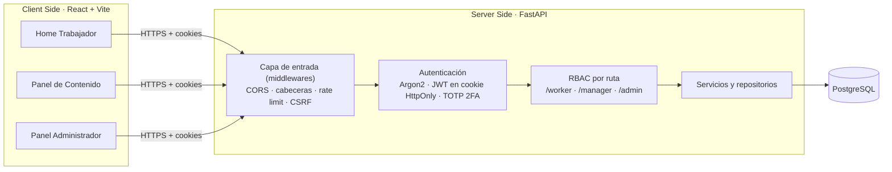

# Inka-Sec

Bienvenidos a Inka-Sec, una aplicación web pensada para fortalecer el conocimiento básico de ciberseguridad en empresas del Perú.

InkaSec combina **módulos cortos en lenguaje sencillo**, **retos prácticos basados en situaciones reales del trabajo** y un **control de acceso por roles (RBAC)**, para que cada empresa capacite a su personal y mida su avance con indicadores concretos: porcentaje de módulos aprobados, desempeño en retos y temas con más errores.

> 📄 **¿Primera vez con el proyecto?** Sigue la guía paso a paso en [`docs/guia-instalacion.pdf`](docs/guia-instalacion.pdf): clonar, crear el entorno virtual, configurar, revisar y levantar los servicios.

---

## Contenido

- [Problema que resuelve](#problema-que-resuelve)
- [Roles y funcionalidades](#roles-y-funcionalidades)
- [Arquitectura](#arquitectura)
- [Tecnologías](#tecnologías)
- [Estructura del repositorio](#estructura-del-repositorio)
- [Inicio rápido](#inicio-rápido)
- [Cuentas de demostración](#cuentas-de-demostración)
- [Variables de entorno](#variables-de-entorno)
- [Pruebas y análisis de seguridad](#pruebas-y-análisis-de-seguridad)
- [Medidas de seguridad implementadas](#medidas-de-seguridad-implementadas)
- [CI/CD](#cicd)
- [API](#api)
- [Estado del proyecto](#estado-del-proyecto)
- [Cómo contribuir](#cómo-contribuir)

---

## Problema que resuelve

Muchos incidentes en empresas peruanas (fraudes por correo, robo de cuentas, pérdida de información) empiezan con una decisión cotidiana insegura de un trabajador. Las capacitaciones largas y teóricas no cambian ese hábito. InkaSec busca que el aprendizaje sea **breve, práctico y medible**, y que se refuerce en el tiempo (refuerzos a los 7, 30 y 90 días) siguiendo el modelo de cambio de conducta **COM-B** (Capacidad, Oportunidad, Motivación).

## Roles y funcionalidades

| Rol | Qué puede hacer hoy |
|---|---|
| **Trabajador** | Iniciar sesión, ver sus módulos y su avance, completar módulos (diagnóstico COM-B → microlección → preguntas → acción real), ver su reto pendiente y sus temas débiles. |
| **Gestor de contenido** (2FA obligatorio) | Ver estadísticas de los módulos y retos que creó (tasa de aprobación, temas con más errores) y crear módulos en borrador clasificados por tema. |
| **Administrador** (2FA obligatorio) | Crear, editar rol/estado, desactivar y eliminar usuarios; crear áreas; consultar la auditoría con búsqueda y paginación; ver indicadores por área y exportar el reporte en CSV. |

Cada empresa solo ve sus propios datos: todas las consultas se filtran por empresa (multiempresa).

## Arquitectura

Arquitectura cliente-servidor desacoplada en tres capas. El control de acceso se aplica **en la API en cada petición**; el frontend solo decide qué pantallas mostrar.



## Tecnologías

| Capa | Tecnología |
|---|---|
| Frontend | React 19, Vite 8, oxlint |
| Backend | Python 3.13, FastAPI, SQLAlchemy 2, Pydantic Settings |
| Seguridad | Argon2 (contraseñas), PyJWT (sesión), TOTP RFC 6238 (2FA) |
| Base de datos | PostgreSQL 18 (Docker / Render) · SQLite para desarrollo local rápido |
| Infraestructura | Docker Compose, GitHub Actions, Render |
| Calidad | pytest, Bandit (SAST), npm audit (SCA) |

## Estructura del repositorio

```
Inka-Sec/
├── docker-compose.yml          # db (PostgreSQL) + backend + frontend
├── .env.example                # plantilla del .env de la raíz (credenciales de la BD local)
├── docs/guia-instalacion.pdf   # guía paso a paso para el equipo
├── .github/workflows/ci.yml    # pruebas, SAST, build, auditoría y despliegue
├── frontend/                   # React + Vite
│   └── src/
│       ├── App.jsx             # vistas por rol (trabajador, gestor, administrador)
│       ├── InkaSecLayout.jsx   # barra lateral, navegación y menú de usuario
│       ├── AuthContext.jsx     # estado de sesión
│       └── api.js              # cliente HTTP (cookies + cabecera CSRF)
└── mi-api-fastapi/             # API FastAPI
    ├── .env.example            # plantilla de configuración de la API
    ├── requirements.txt        # dependencias de producción
    ├── requirements-dev.txt    # + pytest, httpx, bandit
    ├── app/
    │   ├── main.py             # creación de la app y middlewares
    │   ├── core/               # configuración, seguridad, middlewares, dependencias RBAC
    │   ├── api/routes/         # auth, worker, manager, admin, health
    │   ├── services/           # lógica de negocio (auth, progreso, dashboards, auditoría)
    │   ├── repositories/       # consultas a la base de datos
    │   ├── models/             # tablas SQLAlchemy
    │   ├── schemas/            # validación de entradas (Pydantic)
    │   ├── data/               # 7 módulos COM-B de ejemplo
    │   ├── seed.py             # datos demo (solo desarrollo)
    │   ├── dev_totp.py         # genera el código 2FA de un usuario demo (solo desarrollo)
    │   ├── dev_seed_challenges.py  # crea 3 retos demo (solo desarrollo)
    │   ├── bootstrap_admin.py  # crea el primer administrador real
    │   └── worker.py           # depura auditoría con más de AUDIT_RETENTION_DAYS
    └── tests/                  # 72 pruebas: funcionales y simulaciones de ataque
```

## Inicio rápido

Requisitos: **Git**, **Python 3.13**, **Node.js 22** y, para la opción con contenedores, **Docker Desktop**.

```bash
git clone https://github.com/XaXAlvaromO/Inka-Sec.git
cd Inka-Sec
cp .env.example .env
cp mi-api-fastapi/.env.example mi-api-fastapi/.env
# Edita mi-api-fastapi/.env: JWT_SECRET_KEY (mínimo 32 caracteres) y DEMO_PASSWORD.
python -c "import secrets; print(secrets.token_urlsafe(48))"   # genera el JWT_SECRET_KEY
```

**Opción A — Docker (todo junto):**

```bash
docker compose up --build
```

**Opción B — Sin Docker (SQLite):**

```bash
# Terminal 1: API
cd mi-api-fastapi
python -m venv .venv
source .venv/bin/activate          # Windows: .venv\Scripts\Activate.ps1
pip install -r requirements-dev.txt
uvicorn app.main:app --reload --port 8001

# Terminal 2: frontend
cd frontend
npm ci
npm run dev
```

| Servicio | URL |
|---|---|
| Aplicación web | http://localhost:5173 |
| API (salud) | http://localhost:8001/api/v1/health |
| Documentación interactiva de la API | http://localhost:8001/docs (deshabilitada en producción) |
| PostgreSQL (solo Docker) | `localhost:5433` |

## Cuentas de demostración

Con `SEED_DEMO_DATA=true` la API crea al arrancar la empresa demo, 7 módulos y estas cuentas. La contraseña de las tres es el valor de `DEMO_PASSWORD`.

| Rol | Correo | 2FA |
|---|---|---|
| Trabajador | `trabajador@inkasec.pe` | No |
| Gestor | `gestor@inkasec.pe` | Sí |
| Administrador | `admin@inkasec.pe` | Sí |

Para obtener el código de 6 dígitos del gestor o del administrador (solo en desarrollo):

```bash
python -m app.dev_totp gestor@inkasec.pe                               # sin Docker
docker compose exec backend python -m app.dev_totp gestor@inkasec.pe   # con Docker
```

Para cargar 3 retos de ejemplo: `python -m app.dev_seed_challenges` (o con `docker compose exec backend ...`).

## Variables de entorno

Los archivos `.env` **nunca se suben a git**. Se crean a partir de las plantillas `.env.example`.

| Variable | Descripción | Valor local |
|---|---|---|
| `JWT_SECRET_KEY` | Clave que firma las sesiones. **Mínimo 32 caracteres** o la API no arranca. | generada |
| `APP_ENV` | `development` o `production`. En producción se exige HTTPS y se ocultan `/docs` y los scripts de desarrollo. | `development` |
| `DATABASE_URL` | Conexión a la BD. En Docker se reemplaza automáticamente por PostgreSQL. | `sqlite:///./inkasec.db` |
| `FRONTEND_ORIGIN` | Único origen autorizado por CORS. No puede ser `*`. | `http://localhost:5173` |
| `COOKIE_SECURE` / `COOKIE_SAMESITE` | Atributos de las cookies de sesión. `Secure=true` obligatorio en producción. | `false` / `lax` |
| `TRUSTED_PROXY_HOPS` | Proxies de confianza delante de la API (Render = 1). Con 0 se ignora `X-Forwarded-For`. | `0` |
| `SEED_DEMO_DATA` / `DEMO_PASSWORD` | Datos demo y su contraseña (mínimo 8 caracteres). Prohibido en producción. | `true` / tu clave |
| `AUDIT_RETENTION_DAYS` | Días que se conserva la auditoría. Mínimo 365 (RNF-06). | `365` |
| `BOOTSTRAP_ADMIN_*` | Primer administrador real (`python -m app.bootstrap_admin`). Contraseña ≥ 12 caracteres y secreto TOTP en Base32. | vacío |

## Pruebas y análisis de seguridad

```bash
cd mi-api-fastapi
python -m pytest -q            # 72 pruebas
bandit -r app -ll -ii          # análisis estático (SAST)

cd ../frontend
npm run lint                   # oxlint
npm run build                  # compilación de producción
npm audit --omit=dev           # dependencias vulnerables (SCA)
```

Las pruebas usan una base SQLite en memoria y su propia configuración (`tests/conftest.py`), así que no tocan tu base de datos ni dependen de tu `.env`.

- `tests/test_progress.py`: reglas de progreso, retos y paneles por rol.
- `tests/test_security.py`: **simulaciones de ataque**. Incluyen:
  - fuerza bruta de contraseña y de 2FA;
  - IP falsificada en `X-Forwarded-For`;
  - tokens JWT alterados, sin firma (`alg none`) o expirados;
  - CSRF;
  - escalamiento de privilegios y acceso a datos de otra empresa;
  - inyección SQL y de fórmulas en el CSV;
  - configuración insegura.

## Medidas de seguridad implementadas

| Amenaza | Defensa | Prueba |
|---|---|---|
| Fuerza bruta de contraseña | Bloqueo de 15 min tras 3 fallos consecutivos (HTTP 423) y límite de 10 intentos/min por IP (HTTP 429) | `test_password_bruteforce_locks_the_account` |
| Fuerza bruta de 2FA | Los códigos fallidos suman al mismo contador; al bloquear, el desafío se invalida | `test_2fa_bruteforce_locks_the_account_and_burns_the_challenge` |
| Robo de sesión por XSS | JWT en cookie `HttpOnly`; `Secure` obligatorio en producción; CSP en la API | `test_session_cookie_flags` |
| Falsificación de tokens | Firma HS256 obligatoria; se exigen `exp`, `iat` y `sub`; el rol se lee de la BD, no del token | `test_forged_tokens_are_rejected` |
| CSRF | Patrón *double submit cookie* en todo POST/PATCH/DELETE | `test_state_changes_require_matching_csrf_token` |
| Escalamiento de privilegios | RBAC verificado en cada ruta (HTTP 403) | `test_each_role_only_reaches_its_own_routes` |
| Acceso a otra empresa (IDOR) | Toda consulta filtra por `company_id` (HTTP 404) | `test_admin_cannot_touch_users_of_another_company` |
| Enumeración de usuarios | Misma respuesta y mismo costo de hash para correos inexistentes | `test_unknown_email_still_pays_the_hashing_cost` |
| Inyección SQL | Consultas parametrizadas con SQLAlchemy | `test_sql_injection_in_audit_search_is_inert` |
| Inyección de fórmulas en CSV | Celdas que empiezan con `= + - @` se exportan como texto | `test_csv_formula_injection_is_neutralized` |
| Claves débiles o expuestas | La API no arranca con un secreto corto; `.env` fuera de git | `test_insecure_configuration_refuses_to_start` |
| Trazabilidad | Auditoría con usuario, IP, fecha UTC y resultado; retención mínima de 12 meses | `test_admin_user_lifecycle` |

## CI/CD

Pipeline en GitHub Actions (`.github/workflows/ci.yml`), con permisos mínimos y los secretos pasados como variables de entorno:

1. **Backend**: pruebas con pytest y SAST con Bandit.
2. **Frontend**: lint, build y `npm audit` de dependencias de producción (falla con severidad alta o crítica).
3. **Deploy a Dev** en Render (solo en `push` a `main` y solo si los dos jobs anteriores pasan).
4. **Smoke test**: espera a que `/api/v1/health` responda 200 (verifica también la conexión a la BD).
5. **Deploy a Producción**: solo si la variable `RENDER_PROD_ENABLED` es `true`.

> En Render configura `APP_ENV=production`, `COOKIE_SECURE=true`, `TRUSTED_PROXY_HOPS=1`, `SEED_DEMO_DATA=false` y un `JWT_SECRET_KEY` propio de 32 caracteres o más.

## API

Prefijo: `/api/v1`. Autenticación por cookie; los métodos que modifican datos requieren la cabecera `X-CSRF-Token`.

| Método | Ruta | Rol |
|---|---|---|
| GET | `/health` | Público |
| POST | `/auth/login` · `/auth/2fa/verify` | Público |
| GET · POST | `/auth/me` · `/auth/logout` | Autenticado |
| GET | `/worker/dashboard` · `/worker/modules/{id}` | Trabajador |
| POST | `/worker/modules/{id}/comb` · `/worker/modules/{id}/complete` · `/worker/challenges/{id}/answer` | Trabajador |
| GET · POST | `/manager/dashboard` · `/manager/content` | Gestor |
| GET · POST · PATCH · DELETE | `/admin/users` · `/admin/users/{id}` | Administrador |
| GET · POST | `/admin/areas` | Administrador |
| GET | `/admin/dashboard` · `/admin/audit` · `/admin/reports/summary` · `/admin/reports/export` | Administrador |

El detalle de cada ruta está en http://localhost:8001/docs mientras corre la API en desarrollo.

## Estado del proyecto

| Requerimiento | Estado |
|---|---|
| RF-01 Acceso con roles y 2FA | ✅ Implementado |
| RF-02 Gestión de usuarios y áreas, auditoría | ✅ Implementado (edición limitada a rol y estado) |
| RF-03 Gestión de contenidos | 🟡 Parcial: crear borradores por tema; falta editar, publicar y crear retos desde la interfaz |
| RF-04 Asignaciones, plazos y notificaciones | ⏳ Pendiente (existe el modelo de datos) |
| RF-05 Evaluación con retos y retroalimentación | 🟡 Parcial: la API evalúa y da retroalimentación; falta conectar el botón «Resolver reto» |
| RF-06 Seguimiento, estadísticas y reportes | ✅ Implementado (errores agrupados por tema) |
| RF-07 Certificados | ⏳ Pendiente |

**Inconsistencias conocidas del frontend**:

- «Temas a reforzar» y «Temas con más errores» esperan los campos `name`/`score` y `errorRate`, pero la API envía `topic`/`errors` y `error_rate`.
- El tipo «Reto» del formulario de contenido se ignora: siempre se crea un módulo.
- Las pestañas Retos y Asignaciones del gestor muestran texto provisional.

## Cómo contribuir

1. Crea una rama desde `main`: `git switch -c feature/nombre-corto`.
2. Antes de subir cambios, ejecuta las pruebas, Bandit, el lint y el build (ver arriba).
3. Abre un Pull Request hacia `main`: el pipeline debe pasar para poder desplegar.
4. Nunca subas archivos `.env`, contraseñas ni secretos; usa los `.env.example` como referencia.
